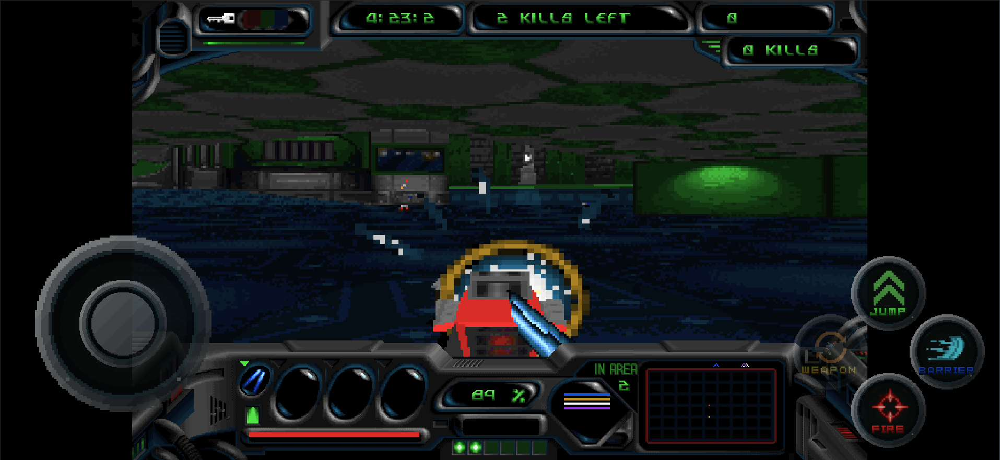

# deathdrome-web

Unofficial browser reimplementation of the 1996 PC game DeathDrome.
The engine is written from scratch in JavaScript.

**[Play in the browser](https://megahertz.github.io/deathdrome-web/)**



## Game files

Original game data is not included. On first start, select one of:

- the free demo ZIP (about 5 MB, one arena, no music);
- a data-only ISO of the CD (about 26 MB, no music);
- a ZIP with the full CD as BIN/CUE (with music).

The file is unpacked in your browser and cached there. Nothing is uploaded.
The demo is available on the Internet Archive.

## Run

Requires Python 3 and Node.js.

```
npm start
```

Open http://localhost:8080/. The server also prints a LAN address for phones.

To skip the file picker, put the full CD at `private/disc/Death-Drome_Win_EN.zip`.
It loads automatically. Other files open by URL, for example
`http://localhost:8080/?image=/private/disc/DDROME.zip`.

## Build

```
npm run build
npm run check:dist
```

## Layout

- `src/` — engine and loader code.
- `public/` — static files published as is.
- `utils/` — dev server, build, importer and tests.
- `private/` — local original media, never committed.
- `dist/` — build output, never committed.

## License

Code is MIT, see [LICENSE](LICENSE). Third-party code keeps its own license:

- three.js — MIT
- Pyodide — MPL-2.0, with Python under the PSF license
- unshieldv3 — Apache-2.0

## Legal

This is a fan project. It is not affiliated with or endorsed by the owners of DeathDrome.
DeathDrome is © 1996 Viacom International Inc. The repository contains no original game data.
